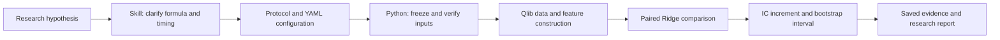

<div align="center">

# 🧪 Qlib Hypothesis Lab

**From a natural-language factor hypothesis to a reproducible research decision.**

🧠 Agent Skills · 📈 Quantitative Research · 🐍 Python · 🔬 Microsoft Qlib

[Usage examples](#-skill-in-action) · [Quick Start](#-quick-start) · [Worked result](examples/reversal-volume/results.md) · [Read the skill](skills/qlib-hypothesis-lab/SKILL.md) · [Reproduce](docs/reproducibility.md) · [CLI guide](docs/usage.md)

</div>

---

Can an agent turn a market intuition into a disciplined experiment? This project combines an **agent skill for research judgment** with a **Python runtime for deterministic calculations**, using [Microsoft Qlib](https://github.com/microsoft/qlib) for US equity data and expressions.

> 💡 **One research goal → a defined experiment → a report backed by evidence.**
>
> The worked case tests low-volume reversal. Its confidence interval crosses zero: **incremental value was not supported** under the predefined protocol. The project preserves that result.

## 💬 Skill in action

**Describe the goal. The skill organizes the research and asks about key ambiguities.**

| Your goal | What you get | Local market data? |
|---|---|:---:|
| 🔬 Reproduce a complete study | Models, metrics, uncertainty and a report | ✅ |
| 📝 Shape a market intuition | A testable question, configuration and protocol | — |
| ⏳ Explore a new window | A separate full study and comparison | ✅ |
| 📄 Bring a paper | Attributed hypotheses and a feasibility assessment | — |
| 🔎 Understand a saved run | Evidence-backed interpretation | — |
| 🛠️ Diagnose a failure | Cause, unfinished stages and proposed correction | — |

Open this repository in Codex first. Calculation examples need the [Quick Start](#-quick-start) environment and dataset; other examples need the relevant saved files or paper. These prompts are illustrative, not separately benchmarked runs.

### 🔬 One prompt → a complete study

```text
Use the qlib-hypothesis-lab skill to reproduce the reversal-volume example
with the project settings and my local data. Run the full study and explain the results.
```

The short request starts the full workflow defined by the skill and example protocol:

| The skill handles | You receive |
|---|---|
| 📝 Define the experiment | A clearly defined experiment with signal and label timing. |
| 🔒 Validate and freeze inputs | Configuration, protocol and implementation snapshots. |
| ⚖️ Fit paired models | A controlled comparison on identical samples. |
| 📊 Evaluate incremental value | Daily Rank IC, paired mean increment and a bootstrap interval. |
| 🔍 Examine supporting evidence | Annual slices, standalone factor IC, quintile returns and signal rank changes. |
| 📄 Interpret and report | A research report, conclusion, uncertainty and file paths. |

> ⏳ **Full research run:** historical data → features → model fitting → 1,000 bootstrap resamples. Duration depends on data and hardware; no fixed runtime has been benchmarked.

**📂 Open the result:** follow the returned `report.md` path in the new `runs/full-<UTC timestamp>/` directory. See the [result preview](#-what-does-the-result-look-like) below.

<details>
<summary><strong>📝 Start with a market intuition</strong></summary>

```text
Use the qlib-hypothesis-lab skill: does low trading volume make short-term
reversal more predictive? Help me design a test before running it.
```

**🧠 The skill handles:** clarifying the hypothesis, defining formulas and timing, checking feasibility and separating standalone predictiveness from incremental value.

**📦 You receive:** a research design and, once substantive choices are resolved, a YAML configuration and protocol. No model training is needed at this stage.

</details>

<details>
<summary><strong>⏳ Explore a new window</strong></summary>

```text
Use the qlib-hypothesis-lab skill to test 10-day reversal instead of five-day
reversal. Keep the other project settings, run a separate full study,
and compare it with the original example.
```

**🧠 The skill handles:** adapting the formula and complete-window checks, saving a separate configuration/protocol, running the full workflow and interpreting the actual evidence. The reused evaluation period remains marked as previously seen.

**📦 You receive:** a fresh run with primary and auxiliary metrics, a report and a comparison with the original case. This is exploratory research and requires new calculations; no outcome is claimed in advance.

</details>

<details>
<summary><strong>📄 Bring a paper</strong></summary>

Provide a paper link, attachment or excerpt, then ask:

```text
Use the qlib-hypothesis-lab skill to find a testable price/volume hypothesis
in this paper and help me turn it into a Qlib experiment.
```

**🧠 The skill handles:** retaining sources and original definitions, listing candidate hypotheses for you to choose from, and assessing what the runtime can express.

**📦 You receive:** a proposed experiment or explicit adaptation requirements. Paper access depends on the supplied source; unsupported formulas, models or data types need adaptation before execution.

</details>

<details>
<summary><strong>🔎 Understand a completed run</strong></summary>

Replace the placeholder with your actual run directory:

```text
Use the qlib-hypothesis-lab skill to explain runs/full-<my-run-timestamp>.
Did the candidate add value, and what evidence supports that conclusion?
```

**🧠 The skill handles:** reading the saved report, status and metrics, distinguishing run types, and interpreting the paired increment and interval alongside auxiliary diagnostics.

**📦 You receive:** an evidence-backed explanation with paths to the result files, without starting a new experiment.

</details>

<details>
<summary><strong>🛠️ Diagnose a failure</strong></summary>

```text
Use the qlib-hypothesis-lab skill to diagnose runs/full-<my-failed-run>
and explain what needs fixing before a rerun.
```

**🧠 The skill handles:** inspecting the failed stage, manifest, checks, failure report and traceback.

**📦 You receive:** a diagnosis, proposed correction and an explanation of which evaluations remain unfinished. The failed run stays available as evidence.

</details>

## 🚀 Quick Start

| Step | Action | Ready for |
|---|---|---|
| 1️⃣ Open | Clone the repo and open it in Codex | Skill discovery |
| 2️⃣ Try | Ask about the saved example | Immediate use, no market data |
| 3️⃣ Configure | Install dependencies and attach your dataset | New experiments |

### 1️⃣ Open the project and discover the skill

```bash
git clone https://github.com/ck2w/qlib-hypothesis-lab.git
cd qlib-hypothesis-lab

# The repository already includes its skill discovery link.
ls -l .agents/skills/qlib-hypothesis-lab
```

Open this folder as your project in **Codex** and start a chat rooted here. No separate global skill installation is needed: `.agents/skills/qlib-hypothesis-lab` points to [`skills/qlib-hypothesis-lab/`](skills/qlib-hypothesis-lab/). Codex supports repository skills and symlinked skill folders; if it does not appear, restart Codex. See the [official skill setup guide](https://learn.chatgpt.com/docs/build-skills#where-codex-loads-local-skills).

**🔎 Check discovery** by sending:

```text
Use the qlib-hypothesis-lab skill. What can it test, and what do I need to get started?
```

**✅ Expected:** the agent reads the skill and explains the supported features, paired Ridge comparison, data requirements and research steps. In Codex CLI or the IDE extension, you can also select the skill with `$qlib-hypothesis-lab`. [Invocation reference](https://learn.chatgpt.com/docs/build-skills#how-chatgpt-and-codex-use-skills)

### 2️⃣ Try it immediately — no market data needed

```text
Use the qlib-hypothesis-lab skill to explain the saved reversal-volume example.
Did the candidate add value? Show me the evidence without rerunning it.
```

**✅ Expected:** an evidence-backed explanation of the published result, including **+0.000097 mean paired IC increment** and a **95% interval crossing zero**. You can inspect the [saved result](examples/reversal-volume/results.md) right away. This path needs neither Python dependencies nor a market-data download.

### 3️⃣ Enable experiments with your local data

For calculation, install **Python 3.12** and **uv**, then run from the repository root:

```bash
uv sync --locked
export QLIB_DATA_DIR="/absolute/path/to/your/snapshot/qlib"

# Optional environment check: 54 core tests, no market data required.
PYTHONPATH=tools uv run --locked python -m pytest -p no:cacheprovider tests --ignore=tests/test_collect_yahoo.py -q
```

| Requirement | What to provide |
|---|---|
| 🐍 Runtime | Python 3.12 and uv; install with `uv sync --locked`. |
| 🗃️ Dataset | Qlib US daily binary data with historical S&P 500 membership, warm-up and label-tail prices. [Checklist](docs/reproducibility.md#2-attach-an-existing-qlib-dataset) |
| 📍 Data path | Set `QLIB_DATA_DIR`; the CLI does not automatically read `.env`. |

> 💡 If Codex is already running, provide the absolute data path in chat and ask it to set `QLIB_DATA_DIR` for execution. A shell export applies only to that process and its children.

You are ready for the [full-study prompt](#-skill-in-action) or the [direct CLI command](#-run-it-locally). Market data is not bundled; the skill needs this repository's runtime for calculations.

## 🧭 Explore in two minutes

| What to inspect | What it demonstrates |
|---|---|
| [🧠 Agent skill](skills/qlib-hypothesis-lab/SKILL.md) | Translating an ambiguous idea into formulas, timing, a protocol and an evidence-backed conclusion. |
| [📝 Research protocol](examples/reversal-volume/experiment.md) | Signal availability, historical membership, boundary purging and a predefined decision rule. |
| [🐍 Python pipeline](tools/lab/) | Separate modules for data, features, samples, models, evaluation, artifacts and reports. |
| [📊 Worked result](examples/reversal-volume/results.md) | A paired comparison with uncertainty and an explicit unsupported result. |
| [🔁 Reproduction guide](docs/reproducibility.md) | Locked dependencies, input snapshots, verification and honest data requirements. |

## 🧠 How the skill and runtime work together



| Layer | Responsibility |
|---|---|
| 🧠 **Agent skill** | Clarify the hypothesis, assess tool support and interpret evidence. |
| 🐍 **Python runtime** | Validate expressions, enforce sample rules, fit models and save metrics. |
| 🔒 **Research protocol** | Fix the comparison and decision rule before execution. |

Unsupported designs require explicit adaptation. An unfavorable result remains part of the evidence.

## 📊 Worked case: reversal × relative volume

Compare two Ridge models trained once on identical 2018–2023 stock-date rows. The baseline uses reversal, relative volume and volatility; the second model adds a standardized reversal × negative-relative-volume interaction. Evaluate on historical S&P 500 members in 2024–2025.

| Evaluation measure | Observed result |
|---|---:|
| Training / evaluation rows | 693,258 / 247,233 |
| Paired evaluation dates | 502 |
| Baseline mean Rank IC | 0.017001 |
| With-candidate mean Rank IC | 0.017098 |
| Mean paired IC increment | +0.000097 |
| 95% moving-block bootstrap interval | [−0.000173, +0.000470] |

> 📌 **Decision: not supported.** The mean increment is positive, but the interval crosses zero. Support requires both a positive mean and an interval lower bound above zero.
>
> 🔁 The evaluation period was already inspected. This case demonstrates workflow reproduction, not a new independent discovery.

Read the [interpretation](examples/reversal-volume/results.md), [machine-readable summary](examples/reversal-volume/results.json), [protocol](examples/reversal-volume/experiment.md) and [configuration](configs/reversal_volume.yaml).

## 💻 Run it locally

Requires **Python 3.12**, **uv**, Git, and an existing **Qlib US daily dataset with historical S&P 500 membership**. Run from the repository root:

```bash
uv sync --locked

# Core tests use synthetic fixtures and do not require market data.
PYTHONPATH=tools uv run --locked python -m pytest -p no:cacheprovider tests --ignore=tests/test_collect_yahoo.py -q

# Set your own Qlib provider path before running the research case.
export QLIB_DATA_DIR="/absolute/path/to/your/snapshot/qlib"
uv run --locked python tools/manual_experiment.py \
  --config configs/reversal_volume.yaml --full \
  --protocol examples/reversal-volume/experiment.md
```

Each run creates a new ignored `runs/` directory with its input snapshots, metrics, diagnostics and `report.md`. **Market data is not included.** Follow the [reproduction guide](docs/reproducibility.md) to check dataset requirements, compare results and understand what the freeze verifies. For development mode, input-only freezing and failure states, see the [CLI guide](docs/usage.md).

## 📂 Inspect your results

| Start here | What to look for |
|---|---|
| 💬 **Agent reply** | Conclusion, key metrics and links to saved evidence. |
| 📄 **`report.md`** | Primary and annual results, auxiliary diagnostics and interpretation. |
| ✅ **`manifest.json`** | `status: completed` for a successful run. |
| 📊 **`summary.json`** | Full-precision metrics; `run_type: formal_out_of_sample` for a full study. |

Open the exact run directory returned in chat or printed by the command. Each execution has a fresh timestamp.

<details>
<summary><strong>🗃️ Expand the full run directory</strong></summary>

```text
runs/full-<UTC timestamp>/
├── report.md                  Human-readable research report
├── manifest.json              Status, environment, stages and outcome
├── checks.json                Checks and recorded diagnostics
├── summary.json               Full-precision primary metrics and models
├── daily_ic.csv               Daily baseline, candidate-model IC and delta
├── annual_ic.csv              Annual slices of the same trained models
├── annual_intervals.json      Per-year uncertainty estimates
├── factor_ic.csv              Standalone factor diagnostics
├── quintile_returns.csv        Candidate group returns and spread
├── quintile_counts.csv         Group sample counts
├── rank_change.csv             Signal rank change diagnostic
├── oos_predictions.csv         Per-stock predictions, kept locally
├── freeze.json                Input hashes and data path
├── config.yaml                Frozen experiment configuration
├── resolved-config.json       Parsed configuration
├── protocol.md                Frozen research protocol
├── tools/                     Frozen implementation modules
├── pyproject.toml             Frozen dependency declarations
└── uv.lock                    Frozen dependency lock
```

This file tree applies to successful full runs. A freeze-only run has no research metrics; a failed run preserves diagnostics and a failure report.

</details>

### 👀 What does the result look like?

An **English presentation of the saved worked case** would read as follows. This is a preview of the evidence-backed explanation, not a new run or a verbatim generated report; the current CLI report headings and some messages remain in Chinese.

| Report item | Worked-case preview |
|---|---|
| ❓ **Question** | Does low relative volume strengthen reversal and improve the baseline? |
| ⚖️ **Method** | Paired Ridge models; train on 2018–2023, evaluate 2024–2025. |
| 🗃️ **Sample** | 693,258 training rows; 247,233 evaluation rows; 502 paired IC dates. |
| 📈 **Mean Rank IC** | Baseline **0.017001** → with candidate **0.017098**. |
| 🎯 **Paired increment** | **+0.000097**, with 95% interval **[−0.000173, +0.000470]**. |
| 📌 **Conclusion** | Incremental value **not supported**: the interval crosses zero. |
| 🔁 **Context** | Evaluation period already seen; prediction diagnostics do not establish tradable returns. |

The generated `report.md` includes pooled and annual primary metrics, factor IC, quintile returns, rank changes, model coefficients and evidence links. Open the public [worked result](examples/reversal-volume/results.md) and [JSON summary](examples/reversal-volume/results.json) to see real aggregate output now. Full daily metrics and predictions are produced locally; they are not included in the public showcase.

For numerical comparison commands, input verification and differences caused by data snapshots, follow the [reproduction guide](docs/reproducibility.md#4-compare-with-the-published-result).

<details>
<summary><strong>🧩 Supported scope and observed validation</strong></summary>

The implementation supports three configured base-feature roles (`rev`, `rv`, `vol20`), a standardized product candidate, paired Ridge models and future-open return labels. Historical expressions use an explicit operator/field whitelist. Other candidate structures, data types or model families require code adaptation.

Three fresh-chat positive prompts selected the skill; a Ref-expression-only near-miss did not. A subsequent skill-driven end-to-end reproduction reached report generation and freeze verification. These observations establish workflow behavior, not a measured improvement over an agent without the skill.

The documented local environment is macOS arm64, Python 3.12, pyqlib 0.9.7 and pandas 2.3.3. Other platforms and a fresh installation are not yet verified. Local validation passed all 55 tests, including the collector test with a separate upstream checkout. The optional Quick Start environment check runs the 54 core tests; see the reproduction guide for the optional collector setup. Some dependencies emit timedelta deprecation warnings.

</details>

<details>
<summary><strong>📐 Research and reproducibility limits</strong></summary>

Rank IC and group-return diagnostics do not model transaction costs, borrowing, capacity or executable portfolio returns. Signal rank changes are not portfolio turnover. An unsupported hypothesis does not prove that an effect is absent.

The public example includes aggregate results and completed-stage status. Raw market data, individual-stock predictions and the full local run are excluded. Freeze verification hashes code, dependencies and protocol/configuration snapshots and checks the data path; it does not hash dataset contents. Matching the original numbers requires the same data snapshot and compatible numerical environment.

</details>

## 🗂️ Repository map

```text
skills/qlib-hypothesis-lab/   English skill and on-demand references
configs/                    Executable experiment configuration
examples/reversal-volume/   Protocol, aggregate results and run status
tools/manual_experiment.py  Research CLI
tools/lab/                  Reusable calculation and evidence modules
tests/                      Configuration, workflow and artifact checks
docs/                       Usage and reproduction guides
```
